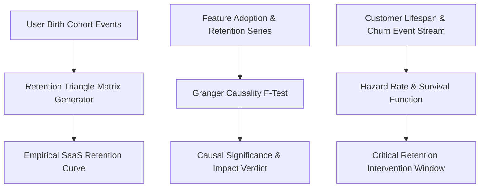

# genpark-growth-data-analyst


GenPark Growth Data Analyst is a zero-dependency SaaS product analytics and retention econometrics engine implementing cohort retention triangle heatmaps, bivariate Granger causality F-tests on feature adoption, and discrete Kaplan-Meier churn hazard rate estimations.



## Features
- **Cohort Retention Triangles**: Calculates multi-period retention matrices and average longitudinal survival curves.
- **Granger Causality Testing**: Computes F-statistics to rigorously verify whether feature adoption causes retention gains.
- **Churn Hazard Inflection**: Pinpoints exact customer drop-off days to trigger proactive customer success playbooks.

## Quickstart

```python
from client import GenParkGrowthDataAnalyst

analyst = GenParkGrowthDataAnalyst()
cohorts = [{"cohort": "2026-01", "cohort_size": 100, "active_users": [100, 50, 40]}]
res = analyst.build_cohort_retention_triangle(cohorts)
print("Avg Retention:", res["average_retention_curve_pct"])
```

## License
MIT
