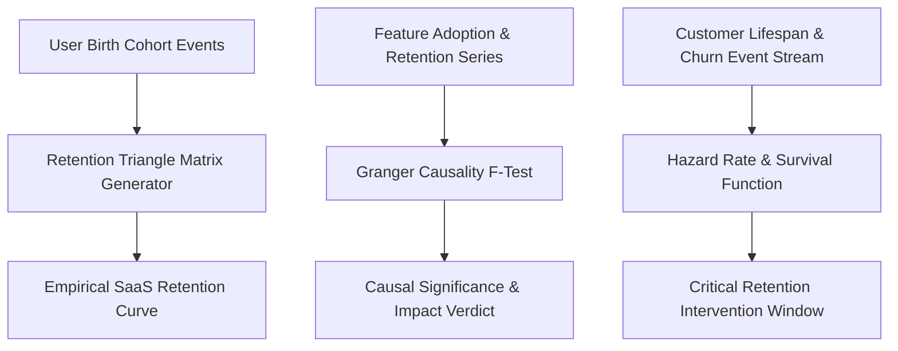

# genpark-growth-data-analyst


GenPark Growth Data Analyst is a SaaS product analytics and retention econometrics engine implementing cohort retention triangle heatmaps, bivariate Granger causality F-tests on feature adoption, and discrete Kaplan-Meier churn hazard rate estimations.



## Features
- **Cohort Retention Triangles**: Calculates multi-period retention matrices and average longitudinal survival curves.
- **Granger Causality Testing**: Computes F-statistics to rigorously verify whether feature adoption causes retention gains.
- **Churn Hazard Inflection**: Pinpoints exact customer drop-off days to trigger proactive customer success playbooks.

## MCP Runtime Requirements

Use Python 3.10+ for the MCP server. The core `client.py` has no external dependencies; MCP transport requires `mcp>=1.0.0,<2`. From this checkout, install it into the Python environment used by your MCP client:

```bash
python -m pip install -r requirements.txt
```

Use the same Python interpreter to launch `mcp_server.py`. In desktop client configuration, set `command` to that interpreter's absolute path.

## Quickstart

```python
from client import GenParkGrowthDataAnalyst

analyst = GenParkGrowthDataAnalyst()
cohorts = [{"cohort": "2026-01", "cohort_size": 100, "active_users": [100, 50, 40]}]
res = analyst.build_cohort_retention_triangle(cohorts)
print("Avg Retention:", res["average_retention_curve_pct"])
```

## Local MCP Server

After installing the MCP requirements, launch the local STDIO server:

```bash
python mcp_server.py
```

Point your MCP client at the absolute path to `mcp_server.py` using the same Python interpreter. This repository does not provide a hosted MCP endpoint.

## License
MIT
